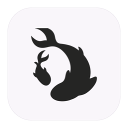
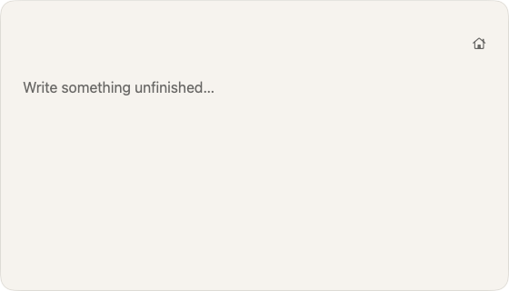

# Rasc

**A scratchpad for unfinished thoughts.**

Rasc is a native Mac app for the place before the note. Invoke it over your work,
capture a thought, optionally Refine it, then Keep it and carry on.
No account, folders, prompts, or organization required.

<p></p>

## Start here

- **Install the app:** [download the latest release](https://github.com/rafaeltorresng/rasc/releases/tag/v0.1.10) and follow the [installation guide](docs/INSTALL-UNSIGNED.md), including the checksum and first-launch steps.
- **Build from source:** follow [Build and test](#build-and-test). This requires Xcode 26.2 or later, Swift 6 and the macOS 26 SDK.
- **Contribute:** start with [Contributing](CONTRIBUTING.md).

## Your first thought

On first launch, choose **Get started**. You can follow the short walkthrough or skip it from a later step. Then, using the default shortcuts:

1. Press `⌥\` to open the Scratchpad and type a thought. Rasc saves locally as you type.
2. Press `Esc` to hide it; press `⌥\` again to continue the same thought.
3. Press `⇧⌘K` to **Keep** it. Rasc clears the scratch and returns you to work.
4. Press `⌘⌥\` to open Home and find the thought.

**Refine** is optional. Press `⌘J` with a thought or passage, compare Suggested and Original, then explicitly accept or use the original.

## Using Rasc

| Action | Default shortcut |
| --- | --- |
| Invoke or hide the scratchpad | `⌥\` |
| New Scratch | `⌘N` |
| Refine the thought or a selected passage | `⌘J` |
| Keep and return to work | `⇧⌘K` |
| Search thoughts | `⌘P` |
| Open Home | `⌘⌥\` |
| Hide and continue the same thought later | `Esc` |

Capture, autosave, Keep, Home and Search work independently of Refine.
Refine offers a conservative edit. Compare Suggested and Original before accepting;
In the current source, **Use original** dismisses the proposal without changing your text (older releases may use a different label).
Discard has Undo while Rasc remains running; it does not introduce a Trash system.



Screenshot from Rasc 0.1.10/build 16 in light mode, using the current Twin Fish mark.

## Requirements and installation

- **App:** macOS 14 or later. Current direct-distribution builds target Apple silicon.
- **Refine:** macOS 26 or later, an Apple Intelligence-capable Mac, Apple Intelligence
  enabled, and its on-device model ready. Rasc remains useful when Refine is unavailable.
- **Development:** Xcode 26.2 or later, Swift 6, and the macOS 26 SDK.

The latest published release is [Rasc 0.1.10, build 16](https://github.com/rafaeltorresng/rasc/releases/tag/v0.1.10): an ad-hoc signed, unnotarized Apple silicon DMG for macOS 14 or later. The repository may contain unreleased changes; version fields alone do not prove a published artifact. See [installation](docs/INSTALL-UNSIGNED.md), the [v0.1.10 notes](docs/RELEASE-NOTES-v0.1.10.md) and the [release runbook](docs/RELEASE.md). Updates are checked manually.

## Build and test

Open `Rasc.xcodeproj`, select the shared **Rasc** scheme and run. Swift packages
are pinned in `Package.resolved`; ThinkingOrbsKit and Sparkle are vendored locally.

```sh
xcodebuild -project Rasc.xcodeproj -scheme Rasc -configuration Debug \
  -derivedDataPath .derivedData/Rasc CODE_SIGN_IDENTITY=- DEVELOPMENT_TEAM= build
xcodebuild -project Rasc.xcodeproj -scheme Rasc -configuration Debug \
  -derivedDataPath .derivedData/Rasc -destination 'platform=macOS' \
  CODE_SIGN_IDENTITY=- DEVELOPMENT_TEAM= test
```

If LaunchServices prevents the native test runner from starting, run the real
non-window suites separately after resolving/building the packages:

```sh
python3 Scripts/test-domain.py
```

This fallback excludes five native window suites. It does not verify keyboard
focus, VoiceOver, fullscreen, Spaces, Stage Manager, or multiple monitors.
Use the [current manual checklist](docs/NATIVE-UI-VALIDATION.md) for those.
The harness runs the scale benchmarks separately from functional tests to avoid
concurrent-suite contention; their original performance thresholds remain intact.

## Privacy and boundaries

Thoughts live in a local SQLite database under Rasc's Application Support directory
(in the app sandbox for packaged builds). No backend, account, telemetry, sync,
cloud inference, or semantic search is required. Refine uses Apple's local
Foundation Models provider, with a fresh request for each operation.
The published Release app is sandboxed and has no outgoing network entitlement. Debug builds are unsandboxed and use a separate local store. The updater build adds
Sparkle's local mach-lookup exceptions and a library-validation exception constrained
by a Library Load Constraint pin.

Refine can still make mistakes. It preserves the original until you accept and
checks revisions, language and protected literals. Review the proposal before
accepting; automated checks do not prove that every meaning is unchanged.

Copy and Share are explicit handoffs. Feedback opens a draft email with app/system
version details; it does not attach your thoughts or send automatically.

The database is not encrypted by Rasc. Discard hides a thought; it does not securely
erase its content or accepted refinement history. There is no built-in backup,
export, sync or recovery UI. See [data, privacy and backup](docs/DATA-AND-PRIVACY.md)
for storage paths and safe manual backups.

## Contributing

Start with [CONTRIBUTING](CONTRIBUTING.md) and the [documentation index](docs/README.md).
Rasc deliberately stays a scratchpad: folders, tags, chat, sync, agents and project
management are outside its current scope. Bug fixes, native craft, accessibility,
reliability and conservative Refine improvements are welcome.

[Source](https://github.com/rafaeltorresng/rasc) ·
[Security reporting](SECURITY.md) · [Community conduct](CODE_OF_CONDUCT.md)

## License

[MIT](LICENSE). Dependency licenses and provenance are listed in
[third-party notices](docs/THIRD_PARTY_NOTICES.md) and included in the app bundle.
