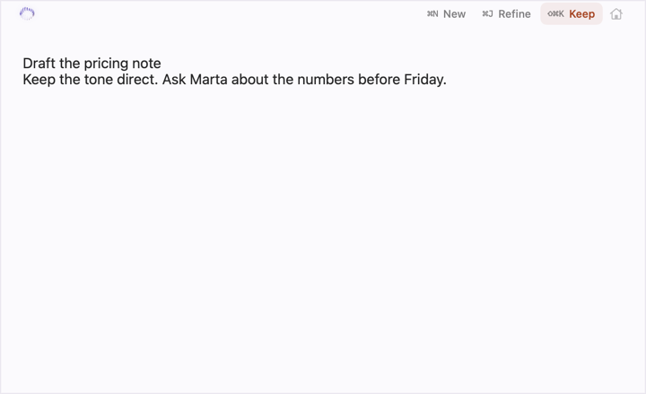
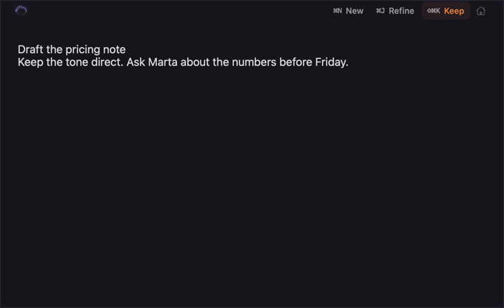
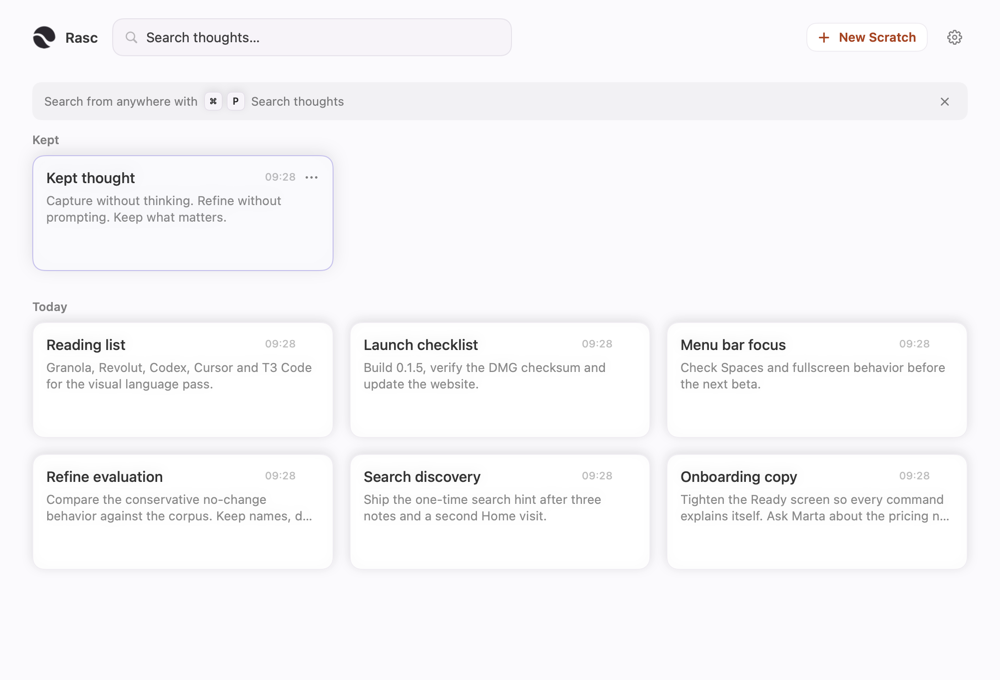
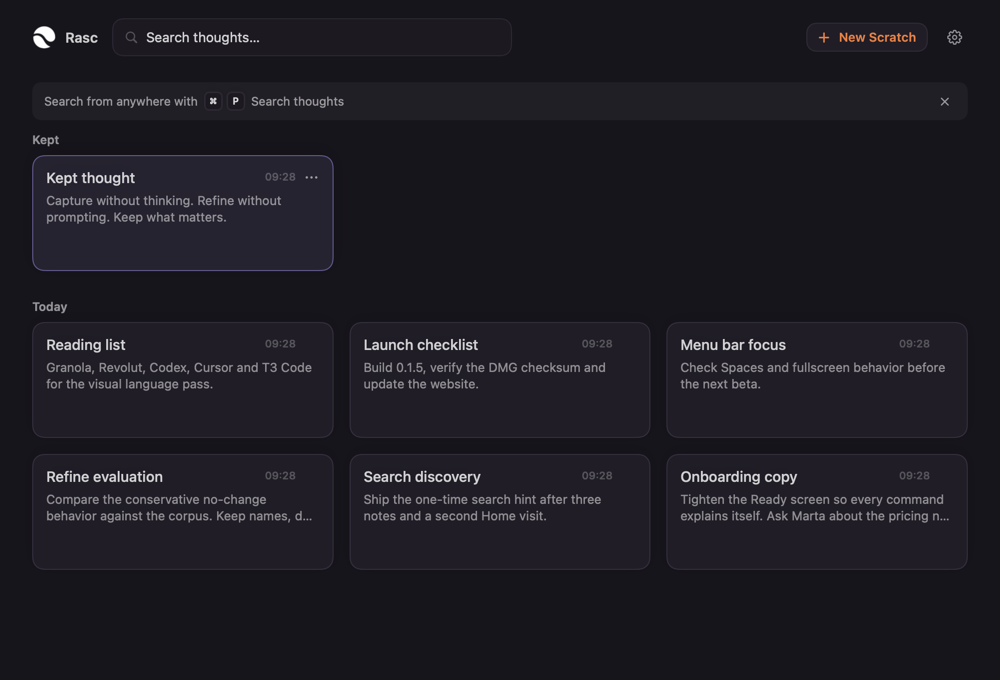
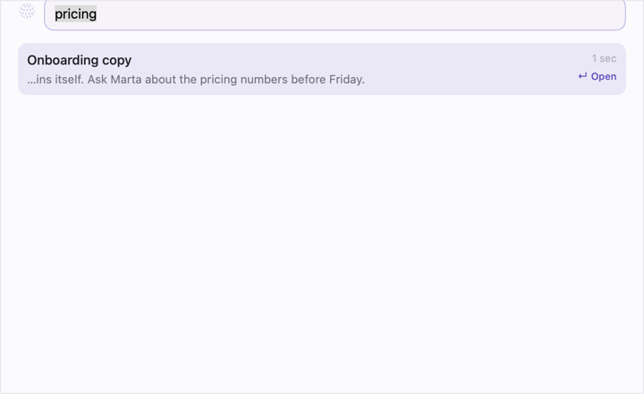
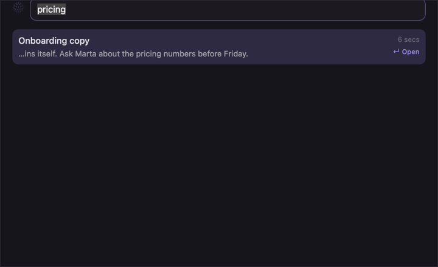
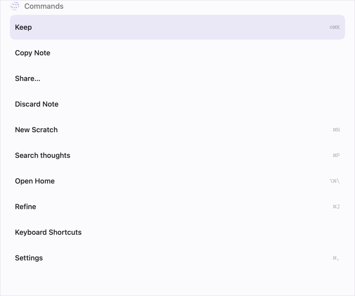
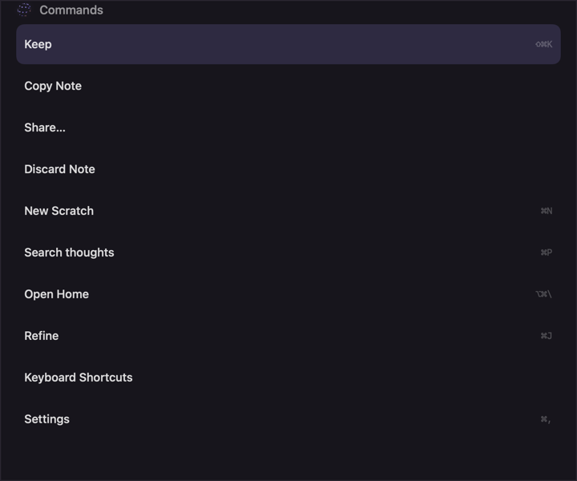
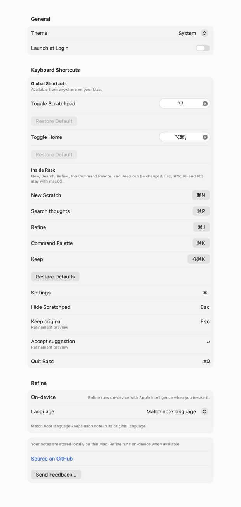
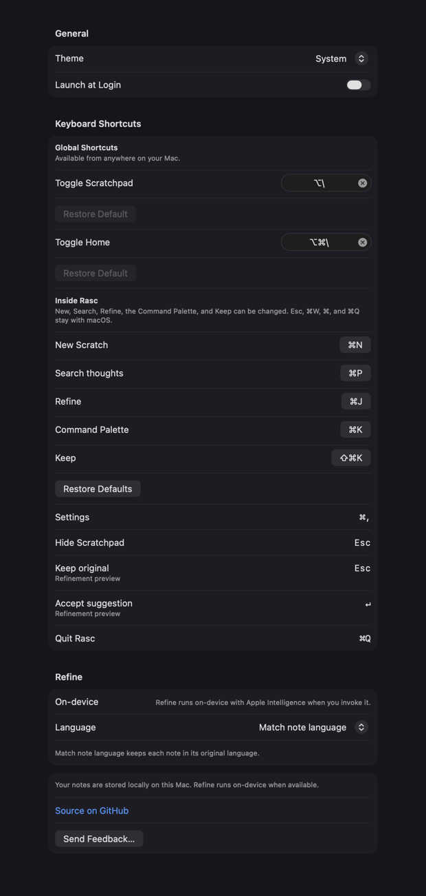

# Rasc — Visual language audit and direction

**Date:** 13 November 2026  
**Revision:** audit at `5786e3d` (`main`), Rasc 0.1.5 (build 11); revised after Slice 1 implementation.  
**Scope:** Scratchpad, Home, Search, Command Palette and Settings in light and dark.  
**Method:** static SwiftUI/AppKit renders at 2×, reviewed at 1×. Sample notes were created in a throwaway SQLite database. The render harness is a temporary target-side suite and is removed after capture.  
**Slice 1 renders:** [after](2026-11-13-visual/slice1/) in light and dark for the same five surfaces, both 1× and 2×. The Settings render is 620×1332 at 1×. **Slice 2 renders:** [slice2](2026-11-13-visual/slice2/) — Search (compact 132 pt) and the two Command Palette states (600 pt with all ten commands; 132 pt filtered) in both appearances. **Slice 3 renders:** [slice3](2026-11-13-visual/slice3/) — the two candidate layouts used for the call, plus the palette's Discard-confirmation state. **Home layout (decided and shipped):** [home](2026-11-13-visual/home/) — compact chronological list, both themes, default/narrow/long-titles/scroll/search states. **Slice 3 Settings renders:** [slice4](2026-11-13-visual/slice4/) — aligned recorder/value edge, disabled restore rows hidden.  
**Not validated here:** live window material/vibrancy, caret and key-window focus, Spaces, fullscreen, Stage Manager, multiple monitors, VoiceOver, Reduce Motion in motion, Increase Contrast in the live panel. These require manual macOS verification and are not claimed.

> **Verdict:** Rasc does not need a rebrand. It already has the beginnings of a distinctive, quiet system. What it lacks is **cohesion**: one action grammar, one metadata voice, and enough contrast for the controls to be found without hunting. The recommended direction is **Warm precision** — keep the paper/graphite calm, make the hierarchy crisp.

---

## 1. What already works

- **The canvas.** `#FBFAFD` paper and `#17151C` graphite are warm without being beige or blue-black. They feel specific to Rasc, not like a default macOS window.
- **The two roles that matter.** The canvas is content; copper is `Keep` and its confirmation, and nothing else. That keeps the one moment of commitment unmistakable without decorating everything around it.
- **The editor.** 16 pt text, generous leading, almost no chrome. Capture is the best-looking surface in the app because it gets out of the way.
- **The brand split.** The symbol/wordmark identifies Home; the Orb communicates activity inside the editor. This follows `BRAND.md` and should not change.
- **Settings is native.** The grouped Form is appropriate for a utility. It should be aligned with the system, not rebuilt as a custom page.
- **Onboarding voice.** The Ready screen’s command descriptions are plain, specific and useful. That is the copy model for the rest of the app.

---

## 2. Evidence

### 2.1 Scratchpad

| Light | Dark |
|---|---|
|  |  |

- Calm and legible; the editor is correctly dominant.
- `⌘N New` and `⌘J Refine` are shortcut-first, low-contrast text; `Keep` is a tinted pill with shortcut-first text; Home is a bare icon. Three affordances in one 32 pt row.
- `New` is an abbreviation of `New Scratch`; the palette and Settings use the full label. The difference is defensible in context, but it is not documented.

### 2.2 Home

| Light | Dark |
|---|---|
|  |  |

- Clear information architecture: search, primary action, kept section, chronological sections.
- Cards are fixed at 116/86 pt browse (108/84 search). Short notes leave a large empty lower half; the grid reads as a dashboard rather than a stack of thoughts.
- Excerpts truncate mid-word (`…pricing n…`), and timestamps use SF Rounded at 10.5 pt while every other metadata treatment is SF Pro or SF Mono.
- The search tip banner duplicates itself: “Search from anywhere with ⌘P Search thoughts”. It is also the heaviest full-width element on the screen.
- Card shadow is the main separator. On paper, a 1 px border would be enough; the shadow makes cards float more than the content warrants.

### 2.3 Search

| Light | Dark |
|---|---|
|  |  |

- The input shell is clear, focused, and consistent with Home’s search field.
- The selected row reads immediately; the `↵ Open` hint is a good keyboard-first detail.
- Snippets can start mid-word (`…ins itself.`). `Note.retrievalSnippet` cuts at a fixed 32-character offset instead of a word boundary.
- Result metadata (`6 secs`, trailing shortcuts) is extremely faint, especially in dark mode.

### 2.4 Command Palette

| Light | Dark |
|---|---|
|  |  |

- The list is well ordered and the selected row is unmistakable. Ten commands fit comfortably; the 50 pt row height is not a problem with content.
- The header is a `Text` label (“Commands”) with a hidden key handler and `focusRingType = .none`. There is no field boundary, caret, or placeholder that says “type”. The palette is keyboard-first, but its primary affordance is invisible.
- Shortcut labels are the faintest text in the app. They are functional information, not decoration.
- `Discard Note` has the same visual weight as `Copy Note` and `Share…`; the destructive command needs a different treatment. Use red text in this visual pass; do not add a behavioral confirmation.

### 2.5 Settings

| Light | Dark |
|---|---|
|  |  |

- Native Form, sensible grouping, readable at a glance.
- Each global shortcut is followed by a full-width, disabled `Restore Default` row. Two dead rows in the common case; four controls for two shortcuts.
- `Restore Defaults` inside the editable group is a full-width row that reads like another command.
- Editable shortcuts use gray keycaps; fixed shortcuts use plain mono text with a different right edge. The trailing value column is not aligned.
- The Refine status puts a full sentence in the value column; at narrow widths it becomes a cramped right-hand paragraph.
- `Source on GitHub` is system blue — the only blue in the app, and a fourth accent after violet, ember and the warm neutrals.

---

## 3. Cross-surface diagnosis

### D1 — Auxiliary text is too faint to do its job (high)

Measured from the resolved system colors against the actual canvas/card colors:

| Role | Light | Dark |
|---|---:|---:|
| `.secondary` on canvas | **3.92:1** | 6.11:1 |
| `.tertiary` on canvas | **1.87:1** | **2.23:1** |
| `.secondary` on Home card | 3.95:1 | 5.86:1 |
| `.tertiary` on Home card | **1.88:1** | **2.26:1** |

The light secondary tone is below 4.5:1 for 12–13 pt text. Tertiary is below 3:1 in both modes. These tones carry snippets, action labels, timestamps and shortcuts — information the user needs, not disabled decoration.

### D2 — There is no single action grammar (high)

The same intents receive different treatments:

| Intent | Scratchpad | Home | Palette | Settings |
|---|---|---|---|---|
| New | shortcut-first text | bordered white pill with ember label | list row | form row |
| Keep | ember tinted pill | — | list row | keycap |
| Search | — | input shell | list row | fixed keycap |
| Restore | — | — | — | disabled full-width row |

Shortcut placement is also split: `⌘N New` in the editor, `New Scratch … ⌘N` in the palette. The user has to relearn the same control on each surface.

### D3 — Metadata has three voices (medium)

- SF Mono for shortcuts in the editor and Settings.
- SF Rounded for timestamps on Home cards.
- SF Pro for timestamps in Search.

The mono is the right voice for key commands; timestamps should be SF Pro with monospaced digits, not a third personality.

### D4 — Home cards are sized for a dashboard, not for thoughts (medium)

Fixed 116/86 pt cards plus a two-line excerpt produce large empty regions for short notes, and mid-word truncation for long ones. The card shadow amplifies the “tile” reading. Content should set the minimum height; the grid can still align rows.

### D5 — Search snippets cut words (medium)

`retrievalSnippet` starts 32 characters before the match, regardless of whitespace. The leading ellipsis then lands inside a word. This is a small bug with a large perceived-quality cost: search results look machine-cut.

### D6 — The palette does not look like an input (high)

The palette opens ready to type, but the header looks like a static label. Search, its sibling surface, has a clear field. Reusing that field shell would make the two retrieval modes feel like one system and remove the discovery gap.

### D7 — Settings spends rows on disabled controls (medium)

`Restore Default` is visible and disabled when the shortcut is already default. Hide it until it can do something; move the group-level restore into a section footer.

### D8 — A fourth accent appears in Settings (low)

System blue links are native, but they break the violet/ember system in the one place where the user is configuring Rasc. Tinting links violet is a small, reversible alignment; keeping native blue is defensible if trust outweighs cohesion.

### D9 — Copy drifts at the edges — **fixed in Slice 4**

`Search from anywhere with ⌘P Search thoughts` repeated the idea twice. Fixed (13 Nov 2026): the banner is now `Search from anywhere` + `⌘P` keycap. `New` / `New Scratch`, `Open Home` / `Toggle Home`, and `Search thoughts` / `Search` remain close-but-not-governed; every label keeps its canonical meaning and contextual abbreviation.

### D10 — Selection semantics need one sentence (low)

Search and the palette use a violet plate; Home uses a violet border and a faint fill; Settings uses native focus. That can be coherent, but it is currently implicit. Write it down so future surfaces do not invent a fourth treatment.

---

## 4. Direction: Warm precision

> **Paper for content. Graphite for focus. Neutral for actions and selection. Copper for Keep — and only Keep.**

Approved 13 November 2026, with one adjustment: the paper and graphite surfaces stay, but copper belongs to `Keep` and its confirmation (`Kept`) alone. New Scratch and Refine are neutral. Search and the palette use a neutral, clearly visible selected row instead of violet. Copper starts from `#9C421F` on `#F5E5DA` in light mode and `#F0A780` on `#382822` in dark mode, both measured at ≥4.5:1 against the fill and ≥4.5:1 against the canvas.

### The four rules

1. **The canvas is the product.** Paper/graphite stays. No gradients, glow, glass decoration, or new brand color. The Orb remains the only ambient motion.
2. **Neutral is the default.** Actions, selected rows, focused field borders and secondary copy are warm neutrals. If no intent is attached, it is not copper.
3. **Copper is commitment, and nothing else.** `Keep`, the palette's `Keep` command, and the `Kept` confirmation are copper. A copper surface never means anything else.
4. **Mono is for the keyboard.** Shortcuts sit trailing their label in SF Mono, `metadataText`. Timestamps use SF Pro with monospaced digits.

### What this is not

- Not a rebrand, new logo, new font, or new icon set.
- Not a Home redesign into lists, folders, tags, or a dashboard.
- Not a custom Settings page.
- Not more chrome, more options, or more decoration.
- Not a density increase in the capture surface.

---

## 5. Proposed system

### 5.1 Text roles

Implemented in `RascSurfacePalette` (`primaryText`, `secondaryText`, `metadataText`, `tertiaryText`) with `NSColor` backers so the contrast contract is unit-tested on the actual values the views resolve:

| Role | Use | Light target | Dark target |
|---|---|---|---|
| `primaryText` | content, selected labels | native primary (≈94%) | native primary |
| `secondaryText` | snippets, descriptions, action labels | 58% black — canvas **5.26:1**, raised **5.20:1**, Home card **5.32:1**, on selection **4.86–4.93:1** | 60% white — canvas **7.07:1**, raised **6.91:1**, card **6.74:1**, on selection **5.50–5.72:1** |
| `metadataText` | shortcuts, timestamps, section labels | 57% black — canvas **5.07:1**, raised **5.01:1**, card **~5.1:1**, on selection **4.69–4.76:1** | 55% white — canvas **6.13:1**, raised **6.02:1**, card **5.88:1**, on selection **4.72–5.07:1** |
| `tertiaryText` | non-essential hints only, never shortcuts | 45% black — **3.31–3.35:1** | 42% white — **4.01–4.09:1** |

Rules:

- Never use `.tertiary` (system or `tertiaryText`) for a shortcut or any functional label. Use `metadataText`.
- Timestamps, snippets, section labels and shortcuts all use `metadataText`; secondary copy uses `secondaryText`. Both are ≥4.5:1 on canvas, raised fill, Home cards and the neutral selection plate.
- The Keep pair is exactly `#9C421F` on `#F5E5DA` (**5.32:1**) and `#F0A780` on `#382822` (**7.05:1**). Copper on the canvas also clears 4.5:1 (**6.28:1** light, **9.09:1** dark), so the chrome `Kept` status and palette `Keep` row can carry copper text without a fill.
- The light `violetText` role is gone; violet is no longer used for list selection or focus borders.

### 5.2 Type

| Element | Size / weight | Notes |
|---|---|---|
| Editor | 16 regular | unchanged; 4.5 line spacing |
| Surface title / input | 15 medium | Search, Palette |
| List row title | 14.5 medium | Search, Palette |
| Card title | 14.5 medium browse / 14 search | unchanged |
| Body / snippet | 13 regular | secondary role |
| Section label | 11.5–12 semibold | metadata role, not tertiary |
| Shortcut | 10.5–11.5 SF Mono medium | trailing, metadata role |
| Timestamp | 10.5–11.5 SF Pro, monospaced digits | no SF Rounded |
| Button / chip | 12–12.5 medium | unified geometry |

### 5.3 Action grammar

| Intent | Treatment | Where |
|---|---|---|
| `Keep` (commit) | copper text on `#F5E5DA` (dark: `#F0A780` on `#382822`), 1 px copper border at 20%, radius 8 | Scratchpad chrome `Keep` and its `Kept` status/confirmation only; the palette lists `Keep` as a neutral row so copper never appears outside the Scratchpad — a decision made 13 Nov 2026 |
| Neutral primary | filled `#26242B` with paper label (light) · filled `#EDE9F0` with graphite label (dark), radius 10, radius 8 for refinement chips | Home `New Scratch` (empty state `.prominent`), refinement `Accept suggestion`, onboarding prominent buttons |
| Secondary | `secondaryText`, transparent at rest, neutral hover fill (`subtleFill`), radius 8 | `New`, `Refine`, `Keep original`, Home header `New Scratch` (bordered neutral), `Home`/`Settings`/`More` icons, header Settings glyph |
| Icon | `secondaryText` glyph, 22–26 pt hit area, hover fill | Home, Settings, More |
| Destructive | system red text; never a red fill in resting chrome | `Discard Note` in the palette and menus — pending Slice 2 |
| Selection (lists) | neutral 10% black / 12% white plate with 1 px neutral border at 18%/26%; never `.tint`, never violet | Search rows, palette rows |
| Selection (Home grid) | faint violet plate + border (unchanged) | Home grid |
| Focus field border | neutral `primary.opacity(0.30 / 0.36)` (`0.75` / increased) | Search and Home input shells |

`New` in the editor stays secondary because it does not commit the current note. `New Scratch` on Home is primary because it starts a new capture, and it carries a neutral primary look — copper remains `Keep`'s alone. The refinement `Accept suggestion` is the one primary-styled action inside the preview footer, in the same neutral filled treatment.

Shortcut placement is consistent: **label first, shortcut trailing**, in SF Mono, `metadataText`. The shortcut is part of the control, not the label — e.g., `Keep ⇧⌘K`, `New ⌘N`, `Refine ⌘J`, `Open ↵`.

### 5.4 Shape, density and surfaces

- Base rhythm: 4 pt. Use 8 / 12 / 16 / 20 / 24.
- Controls/chips: radius 8. List rows: radius 10. Cards, transient containers, previews: radius 12.
- Scratchpad chrome: keep 20 pt horizontal inset and the 20 pt orb. Do not add a title or wordmark.
- Search field: keep 38 pt height, radius 11; Palette header adopts the same shell.
- Palette row: keep 50 pt with ten commands; if the list grows, compact to 46 before adding sections.
- Home card: 100 pt browse / 86 pt compact; 96 pt search / 84 pt compact — **undecided**; the 116/86 grid and a compact chronological list need to be compared before tuning either.
- Home border first: 1 px border, shadow opacity 0.10 → 0.06 light / 0.14 → 0.10 dark; radius 6–8. *(Slice 3.)*
- Settings: native grouped Form, `raisedFill` section cards, 20 pt outer padding. No custom header.

### 5.5 Copy rules

- A shortcut is named once: `Search thoughts`, not “Search … Search thoughts”.
- Use `New Scratch` as the canonical label; `New` is allowed only in the editor chrome where space is tight.
- Keep `Toggle Scratchpad` / `Toggle Home` for global shortcuts; they describe the actual toggle.
- Palette placeholder: `Type a command…` (or `Commands` with a visible caret and field shell).
- Tip banner: `Search from anywhere` + `⌘P` keycap. Remove the repeated “Search thoughts”.

---

## 6. Surface application

**Scratchpad** — *Slice 1 applied*

- Editor unchanged. Chrome actions share one chip geometry: `New ⌘N`, `Refine ⌘J`, `Keep ⇧⌘K` — label leading, shortcut trailing in mono `metadataText`.
- `Keep` is the only copper chip (copper on the approved fill); `Unkeep` is neutral.
- `Kept` status text and the `Kept` transient confirmation render in copper. Other status text (`Refining…`, `Preview`, `Already useful`, …) is `secondaryText`.
- Empty-state guidance and placeholder raised to `secondaryText` / `metadataText` (≥4.5:1).
- Editor canvas, caret (`#lightViolet`/`darkViolet`), orb — unchanged.

**Home** — *Slice 3 applied: compact chronological list*

- The grid is gone; the browse surface is a single-column compact list. Kept stays pinned at the top as a compact section (`KEPT N`, capped at 12 with the same `Show all N kept thoughts` affordance). Every row: title (13.5, one line), optional single-line excerpt, right-aligned timestamp (SF Pro monospaced digits). Search results render in the same list. Selection stays neutral; context menu and hover actions (Unkeep/Copy/Duplicate/Discard) are unchanged; Return / click opens the note; arrow keys move by row (single column); the history tip, empty state, error and undo banners are unchanged.
- Timestamp SF Rounded is gone; all metadata uses SF Pro with monospaced digits.
- Grid constants, `HomeNoteCard`, `HomeNoteGrid` and the grid layout math were removed.
- Header structure kept (symbol, search, `New Scratch`, Settings glyph).
- `New Scratch` is neutral: filled `#26242B`/`#EDE9F0` in the empty state (`prominent`), bordered neutral with primary label in the header. Never copper.
- Snippet and timestamp text raised to `secondaryText` / `metadataText`; the settings glyph and empty-state copy use the same roles.
- Card heights, excerpt word-snapping, timestamp font and the search-tip copy are deliberately not tuned yet — comparing the grid against a compact chronological list first.
- Kept bookmark and section stay neutral; the Home grid selection stays violet for now.
- Final renders in [`slice3/`](2026-11-13-visual/slice3/) were the two candidate layouts; the production layout is the compact list.

**Search** — *Slice 2 applied*

- Snippets snap to word boundaries on both edges, keeping the match in view; multibyte/grapheme content stays intact. `retrievalSnippet(matching:)` now starts/ends on word boundaries when the window allows.
- Selected row is a neutral plate; snippets, timestamps, `Kept` badges and section labels use `secondaryText` / `metadataText`.
- The shortcut hint is `Open ↵` — label first, shortcut trailing, neutral.
- The transient panel resizes to fit: content-driven height, 132 pt floor, 440 pt ceiling, anchored at the top, skipped for user-sized frames (the editor/refining restore behavior and the `switchingSurfacesPreservesPanelFrame` contract are preserved).

**Command Palette** — *Slice 2 applied*

- The header is the same input shell and field as Search — placeholder `Type a command…`, caret, focused plate on open. `Commands` are typed live; Return executes the selected command; Escape closes. The KeyView interceptor is gone.
- Selected row is neutral; shortcuts are trailing mono `metadataText`; the rows are all neutral. Copper is reserved for the Scratchpad's `Keep` button and `Kept` feedback — **the palette's `Keep` row is neutral by decision (13 Nov 2026)**.
- `Discard Note` is destructive red (`#B3261E` / `#FF8A80`), the only tinted row, and Return never defaults to it: palette always opens on the best first command for the current state (Keep in the editor with content), and the choice is covered by a regression test.
- The panel auto-sizes: 132 pt at one row, growing to fit the list (ten commands → 575 pt), sharing Search's compact shell and row styling.

**Settings** — *Slice 1 applied (text roles); alignment and rows applied in Slice 3*

- Secondary captions raised to `secondaryText` (≥4.5:1) in both appearances; no structural or behavioral change. The Form, pickers, toggles and recorder behavior are untouched.
- The two editable global shortcut rows are pinned to the trailing edge (`.frame(maxWidth: .infinity, alignment: .trailing)`), so their value edge shares a column with the mono keycap rows.
- The two per-shortcut disabled `Restore Default` rows are hidden while at default; `Restore Defaults` (group) stays. Footer restore, Refine status reflow, link tint — pending. Native blue links remain documented as undecided (§9).

---

## 7. Implementation slices

Three reviewable PRs, each shippable on its own:

### Slice 1 — Foundation: text roles and action grammar — **implemented**

Files: `Rasc/UI/TransientSurfaceStyle.swift`, `Rasc/UI/RascSurfaceShell.swift`, `Rasc/Features/Scratchpad/ScratchpadView.swift`, `Rasc/Features/Home/HomeView.swift`, `Rasc/Features/Search/HistorySearchView.swift`, `Rasc/Features/Commands/CommandPaletteView.swift`, `Rasc/Features/Onboarding/OnboardingView.swift`, `Rasc/Features/Onboarding/OnboardingScratchpadOverlay.swift`, `Rasc/Settings/SettingsView.swift`.

- `secondaryText` / `metadataText` / `tertiaryText` (≥4.5 / ≥4.5 / ≥3) measured on canvas, raised fill, Home cards and the selection plate; `VisualTokenContrastTests` locks both appearances in.
- Selection in Search and the palette is a neutral plate with a neutral border; focused field border is neutral; the light `violetText` role is deleted.
- Copper is the Keep-only accent (`#9C421F`/`#F5E5DA`, `#F0A780`/`#382822`): chrome `Keep` chip and `Kept` status/confirmation. The palette rows are all neutral by decision (13 Nov 2026). New Scratch, Refine, `Accept suggestion`, onboarding primaries and Home CTAs are neutral.
- Shortcuts trail their label in mono `metadataText` across chrome, refinement footer, search hints and Home/Settings glyphs are `secondaryText`.
- Settings stays native; secondary captions raised to `secondaryText`; editable shortcut rows pin to the trailing edge to share the value column with the monospaced fixed shortcuts; the per-shortcut `Restore Default` rows hide while at default.
- Out of Slice 1 by decision: disabled `Restore Default` rows and Settings structural changes (→ Slice 3), the palette input shell (→ Slice 2, approved), Home card tuning (open comparison).

**Acceptance:** met — no behavior or keyboard-flow change; contrast tests pass; renders re-captured in light and dark to [`2026-11-13-visual/slice1/`](2026-11-13-visual/slice1/) (1× and 2×) for the five surfaces.

### Slice 2 — Retrieval surfaces — **implemented**

Files: `Rasc/Features/Commands/CommandPaletteView.swift`, `Rasc/Features/Search/HistorySearchView.swift`, `Rasc/Features/Commands/PaletteCommand.swift`, `Rasc/Domain/Note.swift`, `Rasc/UI/RascSurfaceShell.swift`, `Rasc/Platform/PanelController.swift`, `Rasc/Features/Scratchpad/ScratchpadSession.swift`.

- The palette header is the shared input shell + field with placeholder `Type a command…`, focused on open (same claim-focus flow as Search). Search finds notes; Commands runs actions.
- `CommandPaletteKeyView` / key interceptor removed; the shared `RascTransientInputTextField` routes ⌃A/⌃D-free native navigation: ↑ ↓ move selection, Return executes, Esc closes.
- Discard Note renders in destructive red (`#B3261E` light / `#FF8A80` dark; ≥4.5:1 on all surfaces incl. selection). Return never defaults to it; the default selection contract is held by the ordering (`Keep` first in the editor) and locked by `commandPaletteDefaultSelectionIsNeverDiscard`.
- Filtered to a single Discard Note (or any Discard Note reached without explicit navigation), Return does not execute — the row shows a deliberate confirmation (“↵ again to discard”) and only a second Return executes. Arrow keys or pointer selection mark the selection as deliberate and execute in one step; Esc cancels. Locked by `CommandPaletteDestructiveGateTests`.
- Search snippets snap to word boundaries, keep the match in view, never split grapheme clusters; `NoteSnippetTests` covers match-at-start, middle, end, match beyond the title line, multibyte, diacritics and an unbroken token.
- The transient panel sizes to content: rows determine height (132 pt floor, 440/700 ceilings, top-anchored); auto-sizing applies only at the default height or last-auto-height, so a user-sized frame is preserved (`switchingSurfacesPreservesPanelFrame` stays green).
- Palette rows all neutral (copper reserved to the Scratchpad `Keep`/`Kept`); palette input field is accent-neutral; the search field keeps the same shell.

**Acceptance:** met in-process — typing, arrows, Return and Esc unchanged in shape; palette opens focused via the same NSTextField first-responder path as Search; snippet tests cover start/middle/end plus multibyte and unbroken tokens; `PanelControllerTests` + new `transientPanelAutoSizesAtTheDefaultSizeAndRestoresItOnReturnToTheEditor` verify the live panel compacts for sparse results and restores the default height on return to the editor. Live macOS focus/Spaces verification is still outstanding (no UI automation available in the agent environment — see §8).

### Slice 3 — Home and Settings polish — **applied**

Files: `Rasc/Features/Home/HomeView.swift`, `Rasc/Settings/SettingsView.swift`, `docs/DESIGN-SYSTEM.md`. Home — compact chronological list applied; candidate renders preserved in [`slice3/`](2026-11-13-visual/slice3/). Final renders in [`home/`](2026-11-13-visual/home/). Settings changes in this pass: aligned recorder/keycap value edge, disabled `Restore Default` rows hidden.

- Home — **decided: compact chronological list.** Kept pinned at top, scannable rows (title, excerpt, date), neutral selection, one layout (no grid toggle, no preview pane), no changes to note opening or keyboard flows. Final renders in [`slice3/`](2026-11-13-visual/slice3/) (candidates) and [`home/`](2026-11-13-visual/home/) (final), in both themes and narrow/long-title/scroll/search states.
- Settings — **applied**: the native grouped Form is kept; the two editable `KeyboardShortcuts.Recorder` rows are pinned to the trailing edge so their value column shares the same right edge as the mono keycap rows; the two per-shortcut `Restore Default` rows are hidden while at default. Disabled restore rows are gone; `Restore Defaults` (group) stays.
- Word-aware excerpts are applied everywhere via `retrievalSnippet` (word-boundary snapping in Search and Home rows); tip copy, section footers, link tint, `DESIGN-SYSTEM.md` — pending the final pass.
- Final light/dark screenshots: Home in [`home/`](2026-11-13-visual/home/), Settings in [`slice4/`](2026-11-13-visual/slice4/).

**Acceptance (partial, by decision):** Home renders pending product choice; Settings alignment and row removal verified by light/dark renders; no new settings.

---

## 8. Validation

- Slice 1: targeted suites green — `VisualTokenContrastTests` (roles, Keep pair, neutral primary, selection), `OnboardingBehaviorTests`, and session suites around both surfaces (`ScratchpadSessionTests`, `RefinementSessionTests`, `HomeSessionTests`, `PaletteCommandTests`, `AppThemeSettingsTests`); 129 tests passed, 0 failed. `Scripts/test-native.sh` still has the four pre-existing `PanelControllerTests` failures on this machine; CI is green.
- Slice 2: 236 tests across 12 suites passed, including `NoteSnippetTests`, `TransientPanelSizingTests`, and `PanelControllerTests` (`switchingSurfacesPreservesPanelFrame` intact; new `transientPanelAutoSizesAtTheDefaultSizeAndRestoresItOnReturnToTheEditor`). PanelControllerTests passes 3/3 consecutive runs at this head; the previously reported fullscreen-overlay failure is flaky and does not reproduce; CI is green.
- Slice 2 hardening: `CommandPaletteDestructiveGateTests` covers the filter-to-Discard-Note path — Return requires a deliberate second confirmation when the selection reached Discard Note by filtering.
- Not verified on this machine: live window behavior (caret, hover states in the real panel, Spaces/fullscreen interactions). The agent environment has no UI automation (System Events automation times out; `screencapture` cannot create an image); debug builds were smoke-checked only (separate bundle id, no personal data). One manual pass on macOS is still required for caret, focus restoration on Return/Escape, and multi-monitor behavior.
- Static renders at 720×440 (Scratchpad, Search), 720×600 (Palette, updated from 720×440), 1000×680 (Home), 620×1332 (Settings) in both appearances, re-captured after Slice 1 — see [`slice1/`](2026-11-13-visual/slice1/).
- Manual checks for live caret/focus, hover, Reduce Motion, Increase Contrast, and the real window material — not yet done for Slice 1; Increase Contrast now uses neutral stroke/focus-border variants.
- Spaces, fullscreen, Stage Manager and multi-monitor behavior are **not** part of a visual-only change; if any window code is touched, verify them manually and do not claim them from snapshots.

---

## 9. Open decisions

1. **Approve “Warm precision”** — *approved 13 Nov 2026*, with the adjustment: copper is `Keep`-only; `New Scratch` and `Refine` are neutral; Search/Palette selection is neutral.
2. **Palette header:** adopt the Search input shell — *approved*; lands in Slice 2.
3. **Home card height / structure:** decided — compact chronological list (kept section pinned at top, neutral selection, one layout).
4. **Settings links:** kept native blue. Violet is reserved for Orb, caret and key-window focus; native blue is the platform-standard link affordance in a utility Settings surface.

---

## Appendix — full-size renders

The images are 1× exports of the 2× captures. The Settings render is intentionally taller than the 680 pt window to show the full form.

Before (13 Nov 2026, pre-Slice 1):

- Scratchpad: [light](2026-11-13-visual/scratchpad-light.png) · [dark](2026-11-13-visual/scratchpad-dark.png)
- Home: [light](2026-11-13-visual/home-light.png) · [dark](2026-11-13-visual/home-dark.png)
- Search: [light](2026-11-13-visual/search-light.png) · [dark](2026-11-13-visual/search-dark.png)
- Command Palette: [light](2026-11-13-visual/palette-light.png) · [dark](2026-11-13-visual/palette-dark.png)
- Settings: [light](2026-11-13-visual/settings-light.png) · [dark](2026-11-13-visual/settings-dark.png)

After Slice 1 (13 Nov 2026; 1× shown, `@2x.png` alongside):

- Scratchpad: [light](2026-11-13-visual/slice1/scratchpad-light.png) · [dark](2026-11-13-visual/slice1/scratchpad-dark.png)
- Home: [light](2026-11-13-visual/slice1/home-light.png) · [dark](2026-11-13-visual/slice1/home-dark.png)
- Search: [light](2026-11-13-visual/slice1/search-light.png) · [dark](2026-11-13-visual/slice1/search-dark.png)
- Command Palette: [light](2026-11-13-visual/slice1/palette-light.png) · [dark](2026-11-13-visual/slice1/palette-dark.png)
- Settings: [light](2026-11-13-visual/slice1/settings-light.png) · [dark](2026-11-13-visual/slice1/settings-dark.png)

Slice 2 (13 Nov 2026; 1× shown, `@2x.png` alongside):

- Search, compact (132 pt): [light](2026-11-13-visual/slice2/search-light.png) · [dark](2026-11-13-visual/slice2/search-dark.png)
- Command Palette, all ten commands (600 pt): [light](2026-11-13-visual/slice2/palette-light.png) · [dark](2026-11-13-visual/slice2/palette-dark.png)
- Command Palette, filtered to `refine` (132 pt): [light](2026-11-13-visual/slice2/palette-filtered-light.png) · [dark](2026-11-13-visual/slice2/palette-filtered-dark.png)
- Command Palette, filtered to `discard` — Return requires confirmation (132 pt): [light](2026-11-13-visual/slice3/palette-discard-confirm-light.png) · [dark](2026-11-13-visual/slice3/palette-discard-confirm-dark.png)

Slice 3 (13 Nov 2026; 1× shown, `@2x.png` alongside):

- Home grid vs. compact chronological list, same notes, both themes: [grid light](2026-11-13-visual/slice3/home-grid-light.png) · [grid dark](2026-11-13-visual/slice3/home-grid-dark.png) · [list light](2026-11-13-visual/slice3/home-compact-light.png) · [list dark](2026-11-13-visual/slice3/home-compact-dark.png)
- Home — final compact list (default / narrow / long titles / 20-note scroll / search active):
  - [light default](2026-11-13-visual/home/home-default-light.png) · [dark default](2026-11-13-visual/home/home-default-dark.png)
  - [light narrow](2026-11-13-visual/home/home-narrow-light.png) · [dark narrow](2026-11-13-visual/home/home-narrow-dark.png)
  - [light long titles](2026-11-13-visual/home/home-long-titles-light.png) · [dark long titles](2026-11-13-visual/home/home-long-titles-dark.png)
  - [light scroll](2026-11-13-visual/home/home-scroll-light.png) · [dark scroll](2026-11-13-visual/home/home-scroll-dark.png)
  - [light search](2026-11-13-visual/home/home-search-light.png) · [dark search](2026-11-13-visual/home/home-search-dark.png)
- Settings with aligned value column and disabled restore rows hidden: [light](2026-11-13-visual/slice4/settings-light.png) · [dark](2026-11-13-visual/slice4/settings-dark.png)
